# k8s-secret-sync-operator

[](https://github.com/ngems1/k8s-secret-sync-operator/actions/workflows/ci.yml)


-success)
[](https://github.com/ngems1/code-clinic)

<p align="center"></p>

A **Kubernetes operator in Python (kopf)**: annotate a ConfigMap whose values are *references*
(`team-a/app/db#password`), and the operator creates and keeps up to date a **Secret** with the
real values from **AWS Secrets Manager** or **Azure Key Vault**. A deny-by-default policy keeps
tenants out of each other's secrets, the Secret is owned by (and deleted with) its ConfigMap,
and no value ever reaches a log.

> **In production, prefer [External Secrets Operator](https://external-secrets.io/)**, a
> mature CNCF project ([ADR 0004](docs/adr/0004-build-vs-external-secrets-operator.md)). This
> repository builds the same idea from scratch so you understand every moving part.

## What you'll learn

- How an operator works: watches, handlers, reconciliation, retries, Kubernetes Events.
- Writing **idempotent** reconciliation: content hashes, all-or-nothing updates, optimistic locking.
- **Ownership**: ownerReferences and garbage collection; refusing to take over what isn't yours.
- The **confused deputy** problem, and why a per-namespace policy is the real security boundary.
- Least-privilege RBAC for a controller, and keyless cloud identity (IRSA, Workload Identity).

## Problem

> Develop a Python Kubernetes operator (or controller) that watches for ConfigMaps with a
> specific annotation and automatically creates corresponding Kubernetes Secrets from AWS
> Secrets Manager / Azure Key Vault. (Code Clinic challenge #12)

**Assumptions**

- The ConfigMap's values are references (`<secret id>[#<json field>]`), never secret values: the
  ConfigMap can live in Git.
- One ConfigMap → one Secret (same name by default). Keys are copied as they are.
- Multi-tenant clusters: namespaces are tenants, and must not read each other's secrets.

## Architecture

```text
  namespace team-a                         namespace secret-sync                 cloud
 ┌──────────────────────────┐   watch    ┌────────────────────────────┐  fetch  ┌──────────────────────┐
 │ ConfigMap app-db         │──────────►│ kopf operator (1 replica)   │───────►│ AWS Secrets Manager   │
 │  sync: "true"            │           │ 1 parse annotations + data  │        │  (IRSA / Pod Identity)│
 │  provider: aws           │           │ 2 policy.toml: namespace →  │        ├──────────────────────┤
 │  DB_PASSWORD: team-a/... │           │   allowed prefixes / vaults │───────►│ Azure Key Vault       │
 │                          │  write    │ 3 fetch ALL values          │        │  (Workload Identity)  │
 │ Secret app-db ◄──────────┼───────────│ 4 write if hash changed     │        └──────────────────────┘
 │  ownerRef → ConfigMap    │  Events   │ timer: resync every 5 min   │
 └──────────────────────────┘◄──────────└────────────────────────────┘
```

| Component | Path | Role |
|---|---|---|
| Spec | [`src/secret_sync/spec.py`](src/secret_sync/spec.py) | annotations + data → validated `SyncSpec` |
| Policy | [`src/secret_sync/policy.py`](src/secret_sync/policy.py) | deny-by-default namespace → AWS prefixes / Azure vaults |
| Providers | [`src/secret_sync/providers/`](src/secret_sync/providers/) | AWS Secrets Manager, Azure Key Vault; permanent vs retryable errors |
| Reconcile | [`src/secret_sync/reconcile.py`](src/secret_sync/reconcile.py) | owned Secret, all-or-nothing, content hash, no takeover |
| Operator | [`src/secret_sync/operator.py`](src/secret_sync/operator.py) | kopf handlers, resync timer, Events, Prometheus metrics |
| Deployment | [`deploy/`](deploy/) | namespace, RBAC, Deployment, NetworkPolicy, policy ConfigMap |
| Image | [`Dockerfile`](Dockerfile) | Python 3.13 slim, from `uv.lock`, non-root, read-only root FS |

## Prerequisites

- Kubernetes 1.33+; for AWS: an IAM role for the operator's ServiceAccount (IRSA or EKS Pod
  Identity) with `secretsmanager:GetSecretValue` on the tenants' prefixes; for Azure: a
  Workload Identity with *Key Vault Secrets User* on the tenants' vaults.
- To develop: Python 3.12+ and [uv](https://docs.astral.sh/uv/), Docker for the e2e test, or the
  **dev container** (image 1.1.0).

## Usage

```bash
# 1. the operator (namespace secret-sync)
kubectl apply -k deploy
# 2. per tenant: a policy entry in deploy/policy.toml AND a RoleBinding (deploy/tenant-rolebinding.yaml)
kubectl apply -f deploy/tenant-rolebinding.yaml
# 3. a tenant asks for a Secret
kubectl apply -f examples/configmap-aws.yaml
kubectl -n team-a describe configmap app-db        # Events: "Secret app-db created (3 key(s) from aws)"
kubectl -n team-a get secret app-db -o jsonpath='{.data.DB_PASSWORD}' | base64 -d
```

```yaml
apiVersion: v1
kind: ConfigMap
metadata:
  name: app-db
  namespace: team-a
  annotations:
    secret-sync.code-clinic.io/sync: "true"
    secret-sync.code-clinic.io/provider: aws            # or azure (+ vault-url)
data:
  DB_USER: team-a/app/db#username                      # a field of a JSON secret
  DB_PASSWORD: team-a/app/db#password
  API_KEY: team-a/app/api-key                          # a plain secret
```

## Examples

| File | What it shows |
|---|---|
| [`examples/configmap-aws.yaml`](examples/configmap-aws.yaml) | AWS Secrets Manager, JSON fields |
| [`examples/configmap-azure.yaml`](examples/configmap-azure.yaml) | Azure Key Vault, custom Secret name |
| [`examples/pod.yaml`](examples/pod.yaml) | a pod mounting the Secret as a volume (rotations reach it without a restart) |
| [`deploy/policy.toml`](deploy/policy.toml) | two tenants, deny by default |

## Configuration

| Annotation (on the ConfigMap) | Required | Meaning |
|---|---|---|
| `secret-sync.code-clinic.io/sync` | yes | `"true"` to opt in |
| `secret-sync.code-clinic.io/provider` | yes | `aws` or `azure` |
| `secret-sync.code-clinic.io/secret-name` | no | target Secret name (default: the ConfigMap's name) |
| `secret-sync.code-clinic.io/vault-url` | azure | `https://<vault>.vault.azure.net` |

| Operator setting | Default | Meaning |
|---|---|---|
| `SECRET_SYNC_POLICY` | `/etc/secret-sync/policy.toml` | namespace → allowed `aws_prefixes` / `azure_vaults`; invalid = won't start |
| `SECRET_SYNC_RESYNC_SECONDS` | `300` | how often each ConfigMap is re-checked (rotations) |
| `SECRET_SYNC_METRICS_PORT` | `9100` | Prometheus: `secret_sync_total{result}`, `secret_sync_last_success_timestamp_seconds` |
| `AWS_DEFAULT_REGION` / `AWS_ENDPOINT_URL` | — | AWS region / an emulator in tests |
| `SECRET_SYNC_AZURE_EMULATOR` | unset | `1` = Lowkey Vault lab mode (dummy token, NO TLS verification): tests only |

## 💰 Cost

| Item | Monthly cost |
|---|---|
| The operator: 50m CPU / 96 Mi requested on an existing cluster | ≈ $1-2 of node capacity |
| AWS Secrets Manager: $0.40 per secret + $0.05 per 10,000 API calls (resync of 10 ConfigMaps × 3 keys every 5 min ≈ 260k calls) | ≈ $1.30 in calls + $0.40 per secret |
| Azure Key Vault (Standard): $0.03 per 10,000 operations | ≈ $0.80 for the same load |
| Local lab (kind + emulators) | $0 |

Resync frequency drives the API bill: every 5 minutes is a good default; every 10 seconds (the
e2e setting) would cost 30× more in calls.

## 🧹 Cleanup / teardown

```bash
kubectl delete -k deploy                          # operator, RBAC, policy
kubectl delete rolebinding secret-sync -n team-a  # per tenant
make e2e-down                                     # the local kind cluster
```

Not removed automatically: the **Secrets** stay as long as their ConfigMaps exist (they are
owned by the ConfigMaps, not by the operator): delete the ConfigMaps to remove them. Cloud
secrets are never touched. kopf's bookkeeping annotations (`secret-sync.code-clinic.io/...`) stay
on ConfigMaps until removed.

## 🏠 Run it locally for free

`make e2e` (or `make e2e-up` to keep the cluster) runs [`tests/e2e/run.sh`](tests/e2e/run.sh):
a kind cluster, the real operator image, and in-cluster fakes of AWS Secrets Manager
(**Moto**) and Azure Key Vault (**Lowkey Vault**). It proves on a real cluster:

1. AWS references (incl. a JSON field) become a Secret owned by the ConfigMap;
2. Azure Key Vault works the same, with a custom Secret name;
3. a rotation in the store reaches the Secret on the next resync;
4. a tenant referencing another tenant's prefix, and an unlisted namespace, are refused (Events);
5. an existing Secret that isn't ours is not overwritten;
6. deleting the ConfigMap deletes its Secret;
7. no secret value appears in the operator's logs, and the operator can't read Secrets in
   `kube-system` or non-tenant namespaces.

## Security considerations

See [docs/THREAT-MODEL.md](docs/THREAT-MODEL.md). Key points:

- **The policy is the tenant boundary** (ADR 0002): without it, editing ConfigMaps in one
  namespace would be enough to read every secret the operator can read. Scope the cloud
  identity to the same prefixes as defence in depth.
- **RBAC:** cluster-wide only read/patch ConfigMaps, create Events, read CRDs; Secret
  permissions are granted per tenant namespace (RoleBinding).
- **No takeover, no partial writes, no values in logs or Events**.
- Keyless cloud identity (IRSA / Pod Identity / Workload Identity); restricted pod; egress
  limited by NetworkPolicy.

## Idempotency notes

Reconciling the same ConfigMap twice with the same values performs **no write** (content hash);
a manual edit of the Secret is restored on the next resync; updates use `resourceVersion`
(optimistic locking). Restarts are safe: `on.resume` re-checks every annotated ConfigMap.

## Running this in production

**Signals to watch**

| Signal | Source | Alert when |
|---|---|---|
| failures | `secret_sync_total{result=~"store_error\|rejected"}` | rising for 15 min |
| staleness | `time() - secret_sync_last_success_timestamp_seconds` | > 3 × resync interval |
| operator down | `kube_deployment_status_replicas_available{deployment="secret-sync"}` | 0 for 5 min |
| Warning Events on ConfigMaps | events exporter | any `PermanentError` |

**Runbook**

1. *"My Secret wasn't created."* `kubectl describe configmap <name>`: the Event says why (bad
   annotation, outside your prefixes, name taken, not found in the store).
2. *"Rotations don't reach my app."* Check `synced-at` on the Secret; env vars need a pod
   restart, volume mounts update automatically (~1 min).
3. *"The operator crash-loops after a policy change."* The policy is invalid (fail closed):
   `kubectl -n secret-sync logs deploy/secret-sync`, fix `policy.toml`; existing Secrets keep working.

**Rolling back:** `kubectl -n secret-sync rollout undo deploy/secret-sync`. Secrets already
written stay in place.

## Testing

```bash
make all      # lint (ruff, mypy, shellcheck, hadolint, actionlint) + 60 tests + manifests + gitleaks + docs
make image    # build + Trivy scan
make e2e      # kind + Moto + Lowkey Vault (Docker, ~10 min)
```

- **60 pytest tests (96% coverage):** spec and policy parsing, providers on Moto's AWS mock and a
  fake Key Vault (permanent vs retryable errors, values never in messages), reconcile rules
  (create/unchanged/update, all-or-nothing, takeover, tamper restore), kopf error mapping.
- **kubeconform** on `deploy/` and the e2e overlay; **hadolint** and **Trivy** on the image.
- **e2e** on kind, as above.

## CI checks

| Job | Runs |
|---|---|
| `repo` (hub) | gitleaks, actionlint, course self-check |
| `python` (hub) | ruff, mypy, pytest (Python 3.13) |
| `image` (hub) | hadolint, build, Trivy (HIGH/CRITICAL fixable) |
| `manifests` (hub) | kustomize build + kubeconform on Kubernetes 1.33/1.35/1.37 |
| `shell` (hub) | ShellCheck |
| `e2e on kind` | `tests/e2e/run.sh` on the runner |

## Repository layout

```text
src/secret_sync/     spec.py · policy.py · providers/ · reconcile.py · kube.py · operator.py
deploy/              operator.yaml · policy.toml · tenant-rolebinding.yaml · kustomization.yaml
tests/               pytest suite · e2e/ (run.sh, overlay with Moto + Lowkey Vault)
examples/            ConfigMaps for AWS and Azure, a pod
docs/                LEARN.md · DRILLS.md · THREAT-MODEL.md · adr/ · images/ · REVIEW-EXERCISE-ANSWERS.md
```

Learn the concepts in [docs/LEARN.md](docs/LEARN.md), break things with
[docs/DRILLS.md](docs/DRILLS.md), review a pull request like a senior with
[docs/REVIEW-EXERCISE-ANSWERS.md](docs/REVIEW-EXERCISE-ANSWERS.md) (branch `review-exercise`),
and read the trade-offs in [docs/adr/](docs/adr/). Part of the
[Code Clinic course](https://github.com/ngems1/code-clinic).

## License

[MIT](LICENSE) © ngems1
